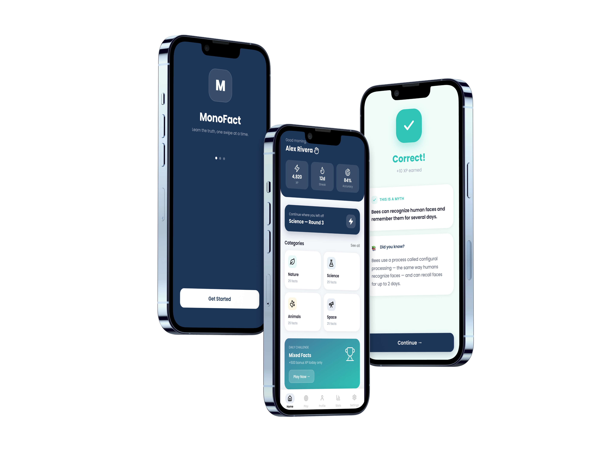
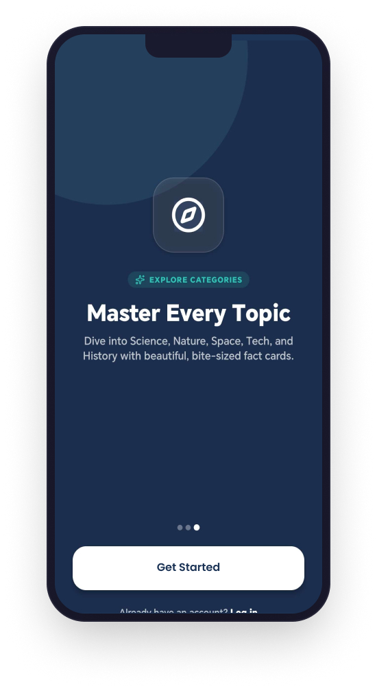
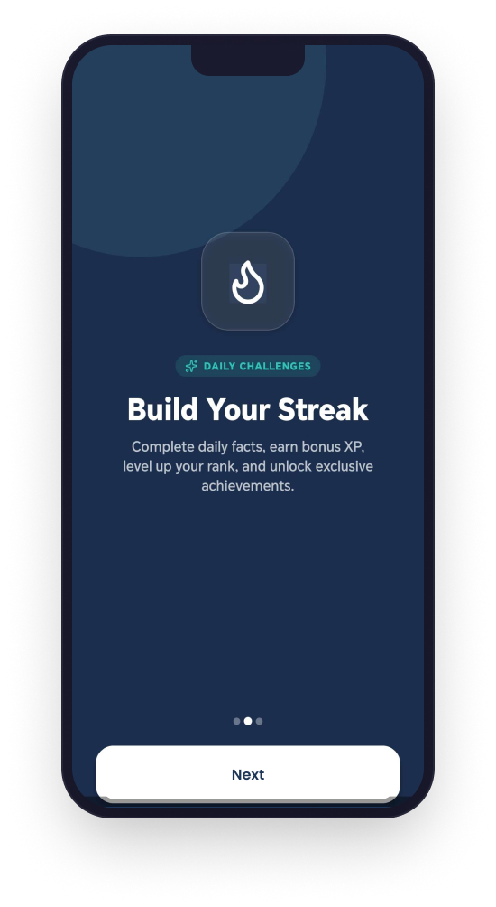
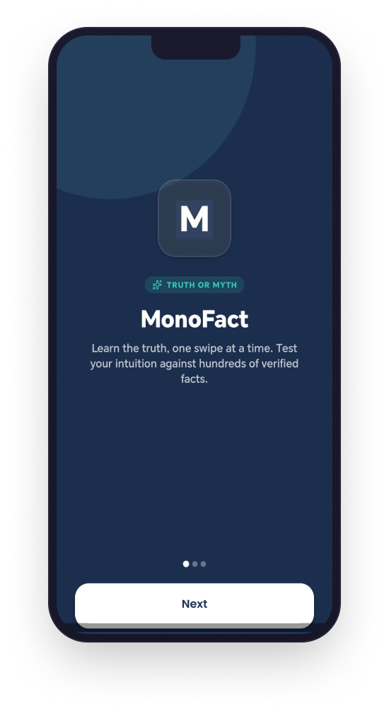
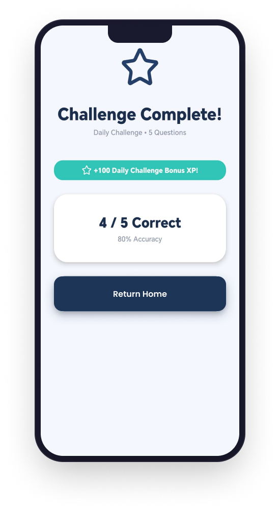
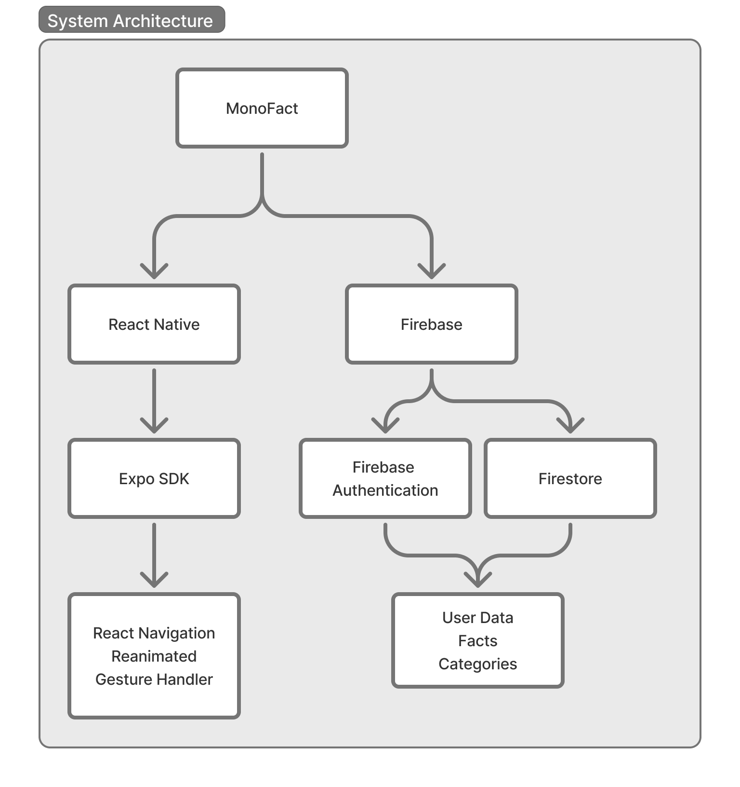
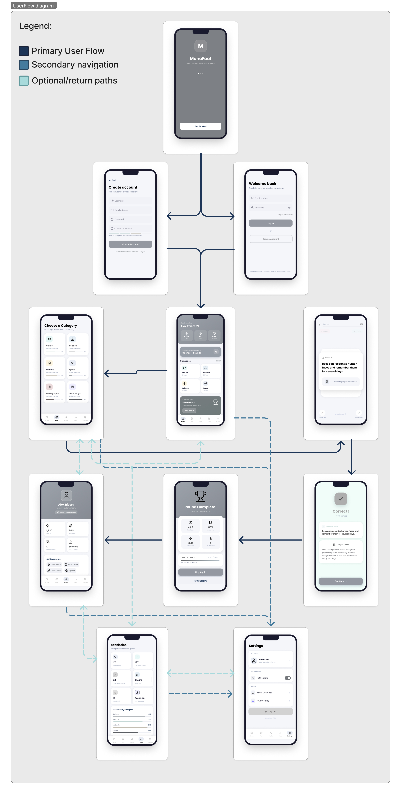

# MonoFact

<div align="center">



### *Test your intuition. Discover the truth.*

</div>

MonoFact is a cross-platform fact-or-myth quiz app built with React Native, Expo, TypeScript, and Firebase.

Players swipe right for **Fact** or left for **Myth**, learn from an explanation, and build XP, streaks, category progress, and achievements.

## Features

- Swipe-based fact-or-myth gameplay
- Six categories: Nature, Science, Animals, Space, Photography, and Technology
- Daily challenge with five facts and bonus XP
- XP, levels, streaks, accuracy, and category progress
- Unlockable achievements, including hidden achievements
- Firebase email authentication and cloud profile/statistics
- Profile photo uploads
- Configurable daily notifications
- Offline fallback for bundled facts, daily challenges, cached progress, and in-progress games
- Light and dark-aware design system with reusable components

> **Offline note:** Existing signed-in users can continue playing when Firebase is unavailable. Facts and progress are stored locally during offline use. Offline progress is not yet synchronized back to Firebase automatically.

## Screenshots

| Splash screen | Onboarding | Onboarding |
|---|---|---|
|  |  |  |

| Login | Register | Home |
|---|---|---|
|  |  |  |

| Categories | Gameplay | Feedback |
|---|---|---|
|  |  |  |

| Daily feedback | Results | Profile |
|---|---|---|
|  |  |  |

| Statistics | Settings | |
|---|---|---|
|  |  | |

## Tech stack

| Area | Technology |
|---|---|
| App runtime | React Native 0.88 and Expo SDK 58 |
| Language | TypeScript 6 |
| Navigation | Expo Router |
| Backend | Firebase Authentication and Firestore |
| Local storage | AsyncStorage |
| Gestures and animation | React Native Gesture Handler and Reanimated |
| Icons | Lucide React Native |
| Testing | Jest and Jest Expo |

## Project structure

```text
MonoFact/
├── app/
│   ├── (tabs)/              # Home, play, profile, stats, and settings
│   ├── auth/                # Login and registration
│   ├── context/             # Shared authenticated-user state
│   ├── game/                # Category, daily, feedback, and results flows
│   ├── settings/            # Account, privacy, and about screens
│   └── services/            # Firebase, facts, deck, stats, and local storage
├── components/              # Reusable UI, cards, gameplay, and navigation
├── constants/               # Colors, spacing, typography, and theme tokens
├── data/facts/              # Bundled JSON fact libraries
├── hooks/                   # Reusable React hooks
├── lib/                     # Shared utilities, including notifications and dates
├── scripts/                 # Fact formatting, checking, and Firestore seeding
└── documents/               # Branding, planning, wireframes, and architecture
```

## Requirements

- Node.js 18 or later
- npm
- Expo Go, an Android emulator, or an iOS simulator
- A Firebase project for authentication and cloud synchronization
- Firebase Admin credentials only if you need to seed Firestore

## Getting started

Clone the repository and enter the Expo project:

```bash
git clone https://github.com/FrancoisleRouxDev/MonoFact.git
cd MonoFact/MonoFact
npm install
```

Create `MonoFact/.env` with the public Firebase configuration:

```env
EXPO_PUBLIC_FIREBASE_API_KEY=your_api_key
EXPO_PUBLIC_FIREBASE_AUTH_DOMAIN=your_auth_domain
EXPO_PUBLIC_FIREBASE_PROJECT_ID=your_project_id
EXPO_PUBLIC_FIREBASE_STORAGE_BUCKET=your_storage_bucket
EXPO_PUBLIC_FIREBASE_MESSAGING_SENDER_ID=your_messaging_sender_id
EXPO_PUBLIC_FIREBASE_APP_ID=your_app_id
EXPO_PUBLIC_FIREBASE_MEASUREMENT_ID=your_measurement_id
```

Start the development server:

```bash
npx expo start
```

Then open the app with Expo Go, an emulator, or a simulator.

## Firebase setup

The app uses Firebase Authentication for accounts and Firestore for cloud facts and user data.

To seed the fact collections:

1. Create a Firebase service-account key.
2. Store it outside the repository.
3. Set `GOOGLE_APPLICATION_CREDENTIALS` to its path.
4. Deploy the Firestore rules.
5. Run the seed script.

```bash
firebase deploy --only firestore:rules
npm run seed
```

Never commit service-account keys or other credentials.

## Available commands

Run these commands from `MonoFact/`:

| Command | Description |
|---|---|
| `npm start` | Start the Expo development server |
| `npm run android` | Build and run the Android app |
| `npm run ios` | Build and run the iOS app |
| `npm run web` | Start the web version |
| `npm run lint` | Run ESLint |
| `npm test` | Run the Jest test suite |
| `npm run seed` | Seed fact data into Firestore |

## Gameplay and progression

- Correct answers award 15 XP.
- Correct-answer streaks award an additional bonus, capped at 90 XP.
- Completing the daily challenge awards 100 bonus XP.
- Category games support 10, 25, 50, or 100 cards where enough facts are available.
- Progress, streaks, achievements, and resume position are persisted locally and, when online, in Firebase.

## Offline behavior

The app uses the JSON files in `data/facts/` as a local fallback when Firestore cannot be reached. Cached user progress is stored per authenticated user using AsyncStorage.

Offline users can currently:

- Play category games
- Play the daily challenge
- Continue an interrupted game
- Record answers, XP, streaks, and category progress locally
- Receive locally scheduled notifications

Online-only operations include new account creation, login, password resets, profile uploads, and cloud synchronization.

## Documentation

Additional project material is available in [`MonoFact/documents/`](MonoFact/documents/), including:

- Branding and design guidance
- Wireframes and user flows
- System architecture
- Planning and database documentation





## License

MonoFact was developed for educational purposes as part of the Bachelor of Creative Technologies programme at The Open Window Institute.
